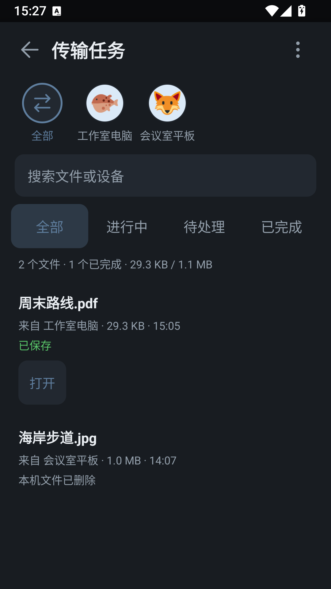

# 飞Q

轻量级 Windows 与 Android 局域网聊天及文件传输工具，支持电脑与手机自由互通，无需注册账号或服务器。

| Windows | Android |
| --- | --- |
|  |  |
|  |  |

## 主要功能

- **即时聊天**：自动发现局域网设备，也可手动添加；支持文字、表情、图片，超长文本自动转 TXT。
- **消息与记录**：支持送达确认、重发、转发、批量删除、置顶备注，以及消息和文件名搜索定位。
- **文件与文件夹**：电脑与手机互传并保留目录，支持断点续传、SHA-256 校验和同名避让；批量上限可调整。
- **传输任务**：按来源、状态和关键词筛选，查看速度与剩余时间，支持暂停、续传、取消和定位原消息。
- **临时浏览器传输**：扫码互传文件夹与纯文本，支持 ZIP 下载、搜索和上传总进度；链接默认 1 小时，文本结束即清（HTTP 明文，仅限可信局域网）。
- **系统集成与清理**：支持 Windows 拖拽、右键发送与 Android 系统分享；接收文件保留单份，可在设置中清理。
- **共享文件夹**：凭 6 位码只读访问，支持分页、搜索、排序、ZIP 和断点下载；增减目录保持连接，浏览器可直接打开常见文件。
- **远程控制**：经连接码与本机确认控制电脑或手机，支持缩放、多屏和断线恢复；可手动推送文本，读取电脑剪贴板需另行授权。
- **安全与网络**：聊天和文件传输使用 TLS 1.2，首次核对配对码；支持 Wi-Fi、以太网、热点、USB 共享及单向 VPN 回连。
- **个性外观**：支持浅色、深色及跟随系统，提供配色、背景、字号和内置／本地头像。

## 使用

1. 从 [GitHub Releases](https://github.com/noway1467/fq/releases) 下载对应包（Windows 需 .NET Framework 4.8，Android 需 8.0 及以上），更新直接覆盖安装即可保留配置与记录。
2. 接入同一 Wi-Fi、以太网、热点或 USB 共享，Windows 运行 EXE、Android 点“连接”；首次连接新版设备在两端核对配对码后信任。
3. 安卓开启 VPN 提示「广播受限」时，点右上角「＋」输入对方局域网 IPv4；顶栏可直达「传输任务」，会话列表下拉可刷新联系人。

安卓「设置 → 通用」默认开启「息屏保持连接」；若手机仍限制后台运行，可点「电池与后台权限」，将飞Q的电池策略设为不限制，并允许系统提供的后台运行权限。

端口默认为 `2425`，一般无需修改；两端均可在「设置 → 通用 → 连接」更改，Windows 重启程序后生效，Android 断开再连接后生效。

## 开发

Windows 使用 .NET Framework 4.8，Android 使用 JDK 17 与 Android SDK 36；构建脚本需 PowerShell 7。

执行 `pwsh -NoProfile -File build.ps1` 或 `pwsh -NoProfile -File build-android.ps1` 构建对应端，追加 `-Test` 运行回归。

本项目源码以 [MIT 许可证](LICENSE) 发布。表情与头像素材来自 [Twemoji](https://github.com/jdecked/twemoji)（[CC BY 4.0](docs/Twemoji-LICENSE-GRAPHICS.txt)）；二维码使用内置 [Project Nayuki QR Code generator](https://www.nayuki.io/page/qr-code-generator-library)（MIT）。
