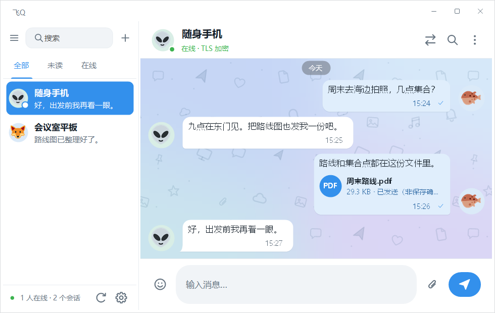

# 飞Q

轻量级 Windows 与 Android 局域网聊天及文件传输工具，支持电脑与手机、手机与手机、电脑与电脑自由互通，无需注册账号或服务器。

## 主要功能

- **即时聊天**：自动发现同局域网设备（也支持通过 `IPv4:端口` 手动添加并记忆历史地址）；支持文字、彩色表情与图片发送（Windows 支持剪贴板粘贴图片，Android 支持输入法图片），超长文本自动转为 TXT 附件完整发送。
- **消息与会话管理**：支持送达确认与失败重发、跨会话转发、查看全文与选段复制、单条/多选删除、草稿保留、会话置顶与备注，以及聊天记录关键词搜索与点击定位。
- **跨端与同端传文件**：支持 **Windows ↔ Android、Android ↔ Android、Windows ↔ Windows** 任意两端互传文件与文件夹（保留目录结构，单批最多 1000 个文件）；支持速率显示、断点续传（邀请保留 7 天，重启后可继续接收）、SHA-256 校验，同名冲突自动改名不覆盖原文件。
- **系统分享与附件管理**：Windows 支持拖拽文件收发及添加右键“发送到飞Q”，Android 支持从其他应用系统分享文本或文件；支持自动/手动接收切换，删除聊天消息保留本地文件，已接收附件也可单独删除本机文件。
- **共享文件夹**：Windows（最多 20 个目录）与 Android 端均可共享本地文件夹，供局域网内其他设备通过 6 位连接码（或已配对凭据）只读浏览、在线播放音视频与断点下载。
- **远程控制**：通过 6 位连接码与本机确认远程查看并操作对方屏幕（支持 Android 控制 Windows 桌面，以及 Windows / Android 控制 Android 手机），支持多屏切换（Windows）、画面缩放与“始终允许此设备”，随时可一键停止。
- **安全连接与协议兼容**：新版设备默认使用 TLS 1.2 与设备证书固定，首次连接核对两端配对码；支持手机热点、USB 网络共享及单向 VPN 下的物理局域网通信；默认兼容旧版 IPMSG 明文协议，可在设置中关闭。
- **个性化外观**：双端统一浅色/深色主题（支持跟随系统）、6 套配色、8 组快捷预设、多种聊天背景图案与自定义背景图、聊天字号调节，支持 24 枚内置头像或导入本地图片头像。

## 使用

1. 从 [GitHub Releases](https://github.com/noway1467/fq/releases) 下载对应版本（Windows 需 .NET Framework 4.8，Android 需 8.0 及以上）。
2. Windows 运行 EXE，Android 安装 APK 后点击“连接”；更新时直接覆盖安装即可，原有设置与聊天记录会保留。
3. 将设备接入同一 Wi-Fi、以太网、手机热点或 USB 共享网络，选择对方即可聊天或互传文件；首次与新版设备连接时在两端核对配对码一致后信任，共享文件夹与远程控制可从菜单打开。

## 开发

Windows 使用 .NET Framework 4.8，Android 使用 JDK 17、Android SDK 36。用 PowerShell 7 执行 `./build.ps1 -Test`、`./build-android.ps1 -Test`；加密与恢复回归执行 `./tests/secure-upgrade.ps1`，双端加密互通执行 `./tests/android-interop.ps1 -Secure -LargeFiles`。

表情与头像素材来自 [Twemoji](https://github.com/jdecked/twemoji)，按 [CC BY 4.0](docs/Twemoji-LICENSE-GRAPHICS.txt) 使用。
