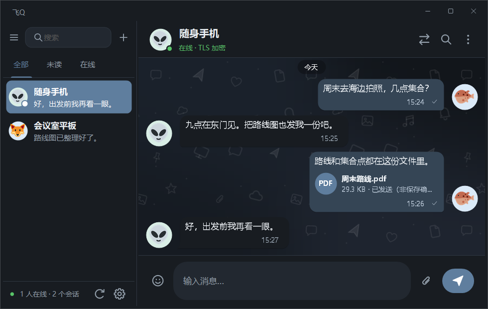

# 飞Q

Windows 和 Android 局域网聊天工具，无需注册账号或服务器。

## 主要功能

- **聊天**：自动发现设备，发送文字和图片，查看历史消息。
- **传文件**：电脑和手机互传文件，中断后可以接着传。
- **附件管理**：删除消息保留文件；已接收附件可单独删除本机文件。
- **安全连接**：新版设备使用 TLS，首次连接核对两端配对码；默认兼容旧版明文聊天和附件，可在设置中关闭。
- **文件夹与系统分享**：保留文件目录结构，单批最多 1000 个文件；支持 Android 分享到飞Q和 Windows 发送到菜单。
- **共享文件**：选择文件夹，让其他设备浏览和下载。
- **远程控制**：通过连接码控制电脑或手机，需被控设备允许。

## 使用

1. 从 [GitHub Releases](https://github.com/noway1467/fq/releases) 下载对应版本。
2. Windows 运行 EXE，Android 安装 APK 后点击连接。
3. 两台设备连接同一个 Wi-Fi、以太网或手机热点（也可使用 USB 网络共享），选择对方即可聊天。

Windows 需要 .NET Framework 4.8，Android 需要 8.0 或更高版本。

更新时直接覆盖安装，保留原有设置和聊天记录。

Windows 可拖动主窗口四边或四角调整大小，最小支持 720×520；拖动联系人栏右侧分隔线可调整宽度，双击恢复默认，关闭后会记住窗口和联系人栏尺寸。聊天输入区随多行文字自动增高，达到上限后可滚动查看。

在聊天记录中搜索后，点击匹配结果可回到会话并定位对应消息，输入草稿会保留。

首次与新版设备聊天、传文件或打开共享/远控时，请在两端核对配对码一致后信任。共享和远控从联系人菜单打开。设备证书发生变化时需先核实，再在联系人菜单撤销旧信任；连接失败不会自动切回明文。0.7.0 升级时默认恢复旧版兼容，之后手动关闭会保持关闭。

Windows 关闭“共享与远控”窗口或远控浮条只隐藏窗口，停止控制请点“断开”或“立即停止远控”。电脑重启并运行飞Q后，已配对设备可继续“连接上次”；选择过“始终允许此设备”的连接会保留该选择。安卓控制 Windows 默认完整显示整个桌面；可点“放大”或“满高”，再拖动查看细节，断开重连后恢复完整显示。

Windows 可在主菜单添加“发送到飞Q”，Android 可从其他应用分享文件或文本。文件邀请保留 7 天；来源仍可读且双方身份未变化时，重启后从历史附件继续接收。文件名冲突不覆盖原文件，目录内空文件夹暂不单独传输。

## 开发

Windows 使用 .NET Framework 4.8，Android 使用 JDK 17、Android SDK 36。用 PowerShell 7 执行 `./build.ps1 -Test`、`./build-android.ps1 -Test`；加密与恢复回归执行 `./tests/secure-upgrade.ps1`，双端加密互通执行 `./tests/android-interop.ps1 -Secure -LargeFiles`。

表情素材来自 [Twemoji](https://github.com/jdecked/twemoji)，按 [CC BY 4.0](docs/Twemoji-LICENSE-GRAPHICS.txt) 使用。
